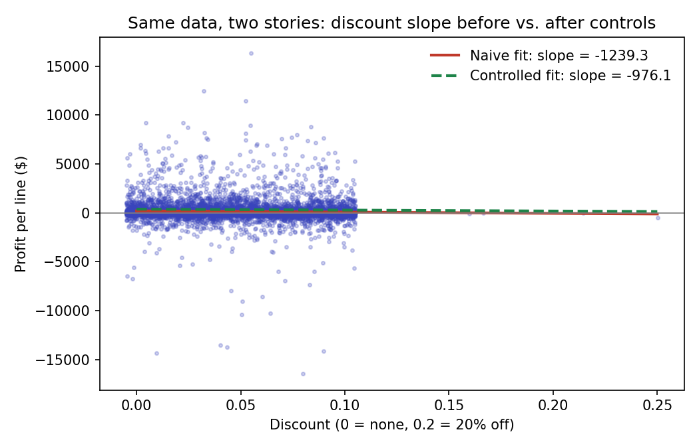
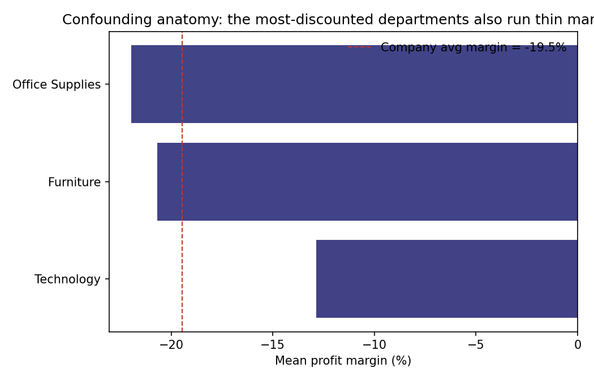

# Correlation vs. Causation: Does Discounting *Cause* Profit Loss?

A statistics-focused companion analysis to my [Superstore sales analysis](https://github.com/fritzbriones/superstore-sales-analysis). Where that project asked *what* drives profit, this one interrogates a single claim the data seems to support — "discounts destroy profit" — and asks what a cautious statistician would actually conclude.

**Key finding, in one paragraph:** A naive model says every 10% discount costs ~$124 of profit per order line. Controlling for department mix, sales volume, order quantity, and product base margin shrinks that to ~$98 — about a fifth of the naive effect was **confounding, not causation** (the departments that discount most, Office Supplies and Furniture, are also the thin-margin ones). Meanwhile the pooled Discount–Profit correlation (r = −0.04, p = 0.0001 at n = 9,426) is statistically significant but practically tiny: **significance tests reliability, not importance.** And with only 5 lines discounted above 20%, this dataset cannot support any claim about deep discounting.

## The three lessons

1. **Significant ≠ important.** With n = 9,426, even r = −0.04 gets p = 0.0001. Report the effect size and the p-value together, never one alone.
2. **Confounding is quantifiable.** Compare the discount coefficient with and without controls: −$124 → −$98 per unit of discount. A real effect survives, but 21% of the naive story was composition (which products get discounted), not the discount itself.
3. **Know where your data ends.** 9,368 of 9,426 lines are discounted 0–10%. The "profit cliff at deep discounts" is extrapolation from 5 rows. See `profit_by_discount_bin.csv`.

Bonus heterogeneity find: pooled, Shipping Cost correlates +0.33 with Product Base Margin, but *within* the Technology department the correlation is −0.34. A pooled correlation can average away opposite underlying realities (a sign-flip cousin of Simpson's paradox).

## Charts

| Naive vs. controlled slope | Confounding anatomy |
|---|---|
|  |  |

## Repo layout

| File | What it is |
|---|---|
| `analysis.py` | Full commented pipeline: correlations → confounding anatomy → OLS naive vs. controlled → bins → charts |
| `superstore_clean.csv` | Tableau Sample Superstore (via Packt *Learning Tableau 10*), 9,426 rows, 2013–2016 |
| `correlation_matrix.csv` | Pearson correlations, all 6 numeric variables |
| `naive_vs_controlled.csv` | The key regression comparison (coefficients, SEs, p, R²) |
| `profit_by_discount_bin.csv` | Profit and unprofitable-share by discount level — including the n = 5 deep-discount rows |
| `simpson_by_subcategory.csv` / `causation_summary.json` | Department-level anatomy + machine-readable findings |

## Reproduce

```bash
pip install -r requirements.txt
python analysis.py
```

All outputs (CSVs, JSON, `charts/`) are regenerated deterministically from `superstore_clean.csv`.

## Method notes

- Correlations: Pearson (numeric pairs, no imputation — the clean file has no missing values in used columns).
- Regression: OLS via statsmodels. Controlled model adds department fixed effects (dummies, baseline = Furniture), `Sales`, `Order Quantity`, `Product Base Margin`.
- Confounding share: `1 − β_controlled / β_naive`.
- This is observational data: "causation" claims here are deliberately conservative — controls shrink the naive effect but cannot fully establish causality (unmeasured confounders remain, e.g. pricing strategy by region).
## Conclusion

**Is discounting associated with lower profit? Yes — but the effect is smaller than a naive analysis suggests.**

After controlling for department mix, sales volume, order quantity, and product base margin, the negative discount–profit relationship remains statistically significant (−$98 per 10% discount, *p* = 0.001). However, the adjusted estimate is approximately 21% smaller than the naive estimate (−$124). This difference suggests that part of the apparent discount penalty reflects department composition: lower-margin departments tend to offer larger discounts. The findings therefore support a more nuanced interpretation: discounting is associated with lower profit within the observed 0–10% range, but the naive model overstates the magnitude of that relationship. Neither "discounts are harmless" nor "discounts destroy profit" adequately captures the evidence.

Three implications follow:

1. **For business decision-makers:** Within the observed discount range, each 10% discount is associated with approximately $98 less profit per line. Any discount policy should therefore be evaluated against the additional volume needed to offset this reduction. However, the dataset cannot support reliable conclusions about deep discounts: only five observations exceed 20%.

2. **For analysts:** Report effect sizes alongside statistical significance, adjust for plausible confounders before making causal interpretations, and explicitly identify the limits of the observed data.

3. **For evidence-based management:** The difference between −$124 and −$98 illustrates why unadjusted relationships can mislead managerial decisions. Statistical adjustment does not automatically establish causality, but it provides a more credible basis for interpreting the relationship and informing decisions.

*The strongest lesson is not simply that discounts are associated with lower profit. It is that asking "but is it causal?" changed the estimated effect by approximately a fifth. Good analysis does not merely produce numbers; it establishes what those numbers can—and cannot—justify.*
*Built as part of a portfolio series while completing a Data Science & Analytics intensive bootcamp.*
