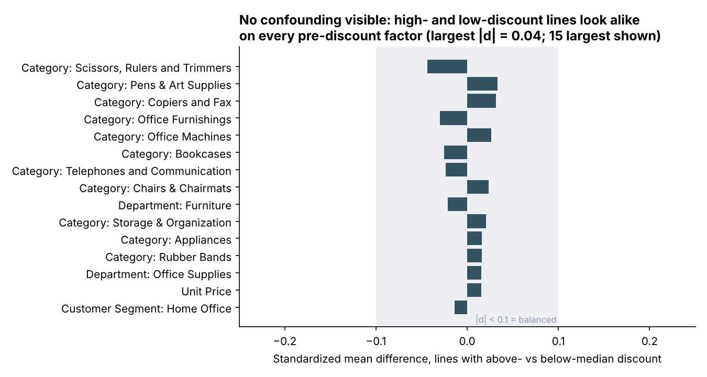
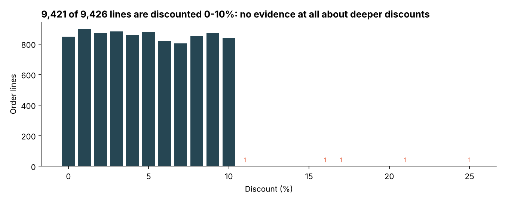

# Correlation vs. Causation: Does Discounting *Cause* Profit Loss?

A statistics-focused companion to my [Superstore sales analysis](https://github.com/fritzbriones/superstore-sales-analysis).
That project found that heavily discounted lines earn thinner margins. This one asks what a
careful analyst can actually conclude from that, and what the business should do about it.

## Answer in one paragraph

Each extra **10 points of discount is associated with $125 less profit per order line**
(95% CI −$184 to −$66). That figure **does not change** when we adjust for everything known
before the discount was set: department, 17 sub-categories, product base margin, unit price,
region, customer segment and year. High- and low-discount lines look alike on all of these,
so the data shows **no measurable confounding**. Discounts also **don't buy volume**: order
quantity doesn't rise with discount (p = 0.17). Two big limits remain. Every claim covers
only **0–10% discounts** (9,421 of 9,426 lines), and an observational dataset can't rule out
confounders that weren't recorded.

## What the business should do

1. **Pilot lower discounts.** If the association is causal, current discounting costs about **$584K** of profit over four years (95% CI $309K–$859K), roughly 45% of total profit. Nothing in the data shows any volume benefit to offset that. A controlled test (e.g. cap discounts at 5% in some regions for a quarter) is cheap compared with that potential cost.
2. **Start with big-ticket lines.** The median line loses only about **$20** per 10 points of discount, versus $125 on average, so the damage is concentrated in large orders. Discount approval rules should target high-value lines first.
3. **Don't extrapolate.** The data says nothing about 20–50% promotions: only 2 lines exceed 20%.

## Three lessons

1. **Significant ≠ important.** The pooled Discount–Profit correlation is r = −0.04 (p = 0.0001, n = 9,426): statistically real but tiny, since discount explains 0.2% of profit variance. The dollar effect is what matters for decisions.
2. **Bad controls manufacture "confounding".** An earlier version of this repo controlled for *Sales* and *Order Quantity* and reported that 21% of the effect was confounding. Both variables are **affected by the discount itself** (post-treatment). Controlling for them strips out part of the effect rather than removing bias. Using only pre-discount controls, the estimate moves by less than 1%.
3. **Check balance before claiming confounding.** All three departments discount the same on average (4.9%, 4.9%, 5.0%), so department mix *can't* explain the effect, however different their margins (Furniture 5.6%, Office Supplies 20.0%, Technology 19.4%).

Bonus: a pooled correlation can hide opposite relationships. Shipping cost vs product base margin is **+0.33** pooled but **−0.34** within Technology.

## Charts

**The estimate across models.** Pre-discount controls leave it unchanged; only the bad control shrinks it.


**Balance check.** No pre-discount factor differs meaningfully between high- and low-discount lines.


**Where the data lives.** Almost every line is discounted 0–10%.


## Results table (`naive_vs_controlled.csv`)

| Model | Effect per +10 pts discount | 95% CI |
|---|---|---|
| 1. Naive | −$124 | −$183 to −$64 |
| 2. + department | −$119 | −$179 to −$60 |
| 3. + sub-category (17) | −$124 | −$183 to −$65 |
| 4. + base margin, unit price | −$125 | −$184 to −$66 |
| **5. + region, segment, year (main)** | **−$125** | **−$184 to −$66** |
| 6. BAD: + Sales, Order Qty (post-treatment) | −$91 | −$144 to −$37 |
| Median regression (dept, base margin, price) | −$20 | −$28 to −$12 |

## Method notes

- OLS with heteroskedasticity-robust (HC3) standard errors; profit per line is heavy-tailed.
- Balance: standardized mean difference of each pre-discount covariate between lines above and below the median discount (|d| < 0.1 is conventionally balanced; the largest here is 0.04).
- Median regression checks that a few huge lines don't drive the result. They drive its *size*, not its *sign*.
- "If causal" cost = main coefficient × the sum of all line discounts, assuming a linear effect within 0–10%.
- The discount is spread almost perfectly uniformly from 0–10% and is unrelated to every product and customer attribute. That pattern is typical of a **synthetic training dataset**, so treat this as a method demonstration, not evidence about a real retailer.

## Data source

`superstore_clean.csv` is produced by [superstore-sales-analysis](https://github.com/fritzbriones/superstore-sales-analysis) from Packt's *Learning Tableau 10* `Superstore.csv` (verified byte-identical to the [publisher's repo](https://github.com/PacktPublishing/Learning-Tableau-10)). It has 9,426 lines from 2013–2016 for a fictional retailer. It is not Tableau's built-in *Sample – Superstore*.

## Reproduce

```bash
pip install -r requirements.txt
python analysis.py
```

Outputs: `naive_vs_controlled.csv`, `balance_table.csv`, `discount_by_department.csv`,
`correlation_matrix.csv`, `causation_summary.json`, and the three PNGs (deterministic).

*Part of a portfolio series built during a Data Science & Analytics intensive bootcamp.*
